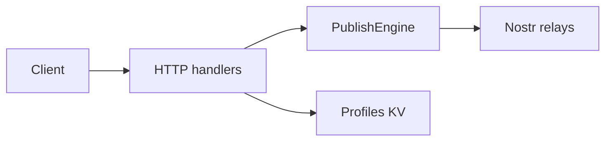

# SmartFlowSocial Publisher

[](https://github.com/xdzczk/smartflowsocial-publisher/actions/workflows/ci.yml)
[](LICENSE)
[](https://nodejs.org/)

HTTP publisher for [SmartFlowSocial](https://smartflow.social). A Cloudflare Worker that accepts signed Nostr events over HTTP and publishes them to relays, with retries, circuit breakers, and rate limits. No WebSocket client is required.

Part of SmartFlowSocial. Related pieces: [app](https://github.com/xdzczk/smartflowsocial), [Blastr](https://github.com/xdzczk/smartflowsocial-blastr), [Blossom](https://github.com/xdzczk/smartflowsocial-blossom), [cache worker](https://github.com/xdzczk/smartflowsocial-cache-worker).

> Documentation: API reference in [docs/API.md](docs/API.md). Architecture in [docs/ARCHITECTURE.md](docs/ARCHITECTURE.md).

## Table of Contents

- [Features](#features)
- [Quick Start](#quick-start)
- [API Overview](#api-overview)
- [Configuration](#configuration)
- [Deployment](#deployment)
- [Architecture](#architecture)
- [Examples](#examples)
- [Development](#development)
- [Troubleshooting](#troubleshooting)
- [FAQ](#faq)
- [Best Practices](#best-practices)
- [Contributing](#contributing)
- [License](#license)

## Security model

The publisher is private infrastructure for SmartFlowSocial. Publish routes require `API_TOKEN`
unless `ALLOW_UNAUTHENTICATED_PUBLISH` is exactly `true`. `GET /health` stays open for probes.

In the default private mode the worker still checks event signatures, limits body size, rate-limits
callers, and refuses relay URLs on loopback, link-local, and private addresses. Set
`ALLOW_PRIVATE_RELAYS` to `true` only for local relays. Set `ENVIRONMENT` to `production` on the
production worker so a missing token fails startup when public mode is off.

Public mode is an explicit choice. It keeps the signature, size, rate-limit, and relay-host checks.
It is not an open proxy to arbitrary private networks.

## Features

- **Simple HTTP API**: Publish Nostr events via REST endpoints—no WebSocket complexity
- **Concurrent Publishing**: Publish to multiple relays simultaneously with configurable concurrency
- **Reliability**: Built-in retry logic, circuit breakers, and health checks
- **Flexible Policies**: Choose between default, conservative, or aggressive publishing strategies
- **Profile Caching**: Efficient profile fetching with Cloudflare KV caching
- **Rate Limiting**: Built-in rate limiting per IP or API token
- **Observability**: Comprehensive logging, metrics, and tracing support
- **Production Ready**: Battle-tested with timeout handling, error recovery, and monitoring

## Quick Start

### Prerequisites

- Node.js 20+ and pnpm
- Cloudflare account with Workers enabled
- Wrangler CLI installed (`npm install -g wrangler`)

### Installation

```bash
# Clone the repository
git clone https://github.com/xdzczk/smartflowsocial-publisher.git
cd smartflowsocial-publisher

# Install dependencies
pnpm install

# Set up Cloudflare KV namespace
wrangler kv:namespace create PROFILES
wrangler kv:namespace create PROFILES --preview
```

Add the KV namespace bindings to `wrangler.toml`:

```toml
[[kv_namespaces]]
binding = "PROFILES"
id = "<your-namespace-id>"
preview_id = "<your-preview-namespace-id>"
```

### Basic Configuration

Create a `.dev.vars` file for local development:

```bash
# Required unless you intentionally run a public publisher.
# Generate: openssl rand -base64 32
API_TOKEN=your-secret-token
# ALLOW_UNAUTHENTICATED_PUBLISH=true
# ALLOW_PRIVATE_RELAYS=true

# Optional: Enable CORS for browser clients
CORS_ENABLED=true
CORS_ORIGINS=https://example.com

# Optional: Configure rate limiting
RATE_LIMIT_REQUESTS=100
RATE_LIMIT_WINDOW_MS=60000
```

### First Request

```bash
curl -X POST https://your-worker.workers.dev/publish \
  -H "Content-Type: application/json" \
  -H "API-TOKEN: your-secret-token" \
  -d '{
    "relays": ["wss://relay.damus.io"],
    "event": {
      "id": "64-character-hex-event-id",
      "pubkey": "64-character-hex-pubkey",
      "kind": 1,
      "created_at": 1234567890,
      "content": "Hello Nostr!",
      "tags": [],
      "sig": "128-character-hex-signature"
    }
  }'
```

For detailed API documentation, see [API.md](docs/API.md). For architecture and design details, see [ARCHITECTURE.md](docs/ARCHITECTURE.md).

## API Overview

The service provides four main endpoints:

| Endpoint          | Method | Description                                 |
| ----------------- | ------ | ------------------------------------------- |
| `/` or `/publish` | POST   | Publish a single event to multiple relays   |
| `/batch`          | POST   | Publish multiple events in a single request |
| `/profile`        | POST   | Fetch a Nostr profile (kind 0 event)        |
| `/health`         | GET    | Check health status of known relays         |

For complete API documentation with request/response examples, error codes, and detailed field descriptions, see [API.md](docs/API.md).

Limits that match the worker (request and response bodies are in [API.md](docs/API.md)):

- `POST /publish`: at most 12 `wss://` relays after normalization, 1 MB body. `?policy=default` is 10s per relay, 15s overall, 1 retry. `conservative` is 20s / 30s / 2 retries. `aggressive` is 5s / 10s / 0 retries. Default concurrency is 8.
- `POST /batch`: at most 200 events, 10 MB body, same policies.
- `POST /profile`: a cached kind-0 profile returns 200. A miss returns 202 and fetches in the background.
- `GET /health`: known-relay health. No body.

Cloudflare Workers stop the isolate at 30 seconds. The worker warns at 25 seconds. A partial relay failure is still HTTP 200 when the request itself is valid. Responses include `X-Request-ID`.

## Configuration

### Environment Variables

All configuration is done through environment variables. Set these in your `wrangler.toml` for production or `.dev.vars` for local development.

| Variable                     | Required | Default | Description                                                                       |
| ---------------------------- | -------- | ------- | --------------------------------------------------------------------------------- |
| `PROFILES`                   | Yes      | -       | Cloudflare KV namespace binding for profile caching                               |
| `API_TOKEN`                  | No       | -       | Secret token for authentication (if set, all requests require `API-TOKEN` header) |
| `CORS_ENABLED`               | No       | `false` | Enable CORS support (`"true"` to enable)                                          |
| `CORS_ORIGINS`               | No       | -       | Comma-separated list of allowed origins (required if `CORS_ENABLED=true`)         |
| `RATE_LIMIT_REQUESTS`        | No       | `100`   | Maximum requests per rate limit window                                            |
| `RATE_LIMIT_WINDOW_MS`       | No       | `60000` | Rate limit window size in milliseconds (default: 1 minute)                        |
| `METRICS_EXPORT_ENABLED`     | No       | `false` | Enable metrics export (`"true"` to enable)                                        |
| `METRICS_EXPORT_INTERVAL_MS` | No       | `60000` | Metrics export interval in milliseconds                                           |

### Cloudflare KV Setup

The profile data is cached in [Cloudflare KV](https://developers.cloudflare.com/workers/runtime-apis/kv/), a global, low-latency key-value data store.

**Setup Steps:**

1. Create KV namespaces:

```bash
wrangler kv:namespace create PROFILES
wrangler kv:namespace create PROFILES --preview
```

2. Add bindings to `wrangler.toml`:

```toml
[[kv_namespaces]]
binding = "PROFILES"
id = "<production-namespace-id>"
preview_id = "<preview-namespace-id>"
```

### Configuration Examples

**Minimal Configuration (Public Worker):**

```toml
# wrangler.toml
[[kv_namespaces]]
binding = "PROFILES"
id = "your-namespace-id"
```

**Production Configuration (Protected):**

```toml
# wrangler.toml
[[kv_namespaces]]
binding = "PROFILES"
id = "your-namespace-id"

[env.production.vars]
API_TOKEN = "your-secret-token"
CORS_ENABLED = "true"
CORS_ORIGINS = "https://yourdomain.com"
RATE_LIMIT_REQUESTS = "200"
RATE_LIMIT_WINDOW_MS = "60000"
```

**Browser Client Configuration:**

```toml
[env.production.vars]
CORS_ENABLED = "true"
CORS_ORIGINS = "https://app.example.com,https://www.example.com"
```

## Deployment

### Step-by-Step Deployment

1. **Configure Environment Variables**
   - Set up KV namespace (see [Configuration](#configuration))
   - Add environment variables to `wrangler.toml` or Cloudflare dashboard

2. **Deploy to Cloudflare**

   ```bash
   wrangler deploy
   ```

3. **Verify Deployment**

   ```bash
   # Test health endpoint
   curl https://your-worker.workers.dev/health

   # Test publish endpoint (if API_TOKEN is set)
   curl -X POST https://your-worker.workers.dev/publish \
     -H "Content-Type: application/json" \
     -H "API-TOKEN: your-token" \
     -d '{"relays": ["wss://relay.damus.io"], "event": {...}}'
   ```

### Deployment Checklist

- [ ] KV namespace created and bound
- [ ] Environment variables configured
- [ ] API_TOKEN set (if protecting worker)
- [ ] CORS configured (if serving browser clients)
- [ ] Rate limiting configured (if needed)
- [ ] Worker deployed successfully
- [ ] Health endpoint responding
- [ ] Test publish request succeeds

### Post-Deployment

- Monitor worker logs in Cloudflare dashboard
- Check metrics and analytics
- Set up alerts for error rates
- Monitor KV usage for profile caching

For more details, see the [Cloudflare Workers documentation](https://developers.cloudflare.com/workers/get-started/guide/).

## Architecture

### System Overview



The worker implements a layered architecture:

1. **Transport Layer** (`src/transport/http/`): HTTP request/response handling, validation, mapping
2. **Core Layer** (`src/core/`): Business logic for publishing, profile fetching, relay management
3. **Adapters** (`src/adapters/`): Protocol-specific adapters (Nostr WebSocket)
4. **Policies** (`src/policies/`): Configurable retry, timeout, and concurrency policies
5. **Observability** (`src/observability/`): Logging, metrics, tracing
6. **Security** (`src/security/`): Input sanitization and validation
7. **Middleware** (`src/middleware/`): Rate limiting, CORS

### Key Components

- **PublishEngine**: Orchestrates concurrent publishing to multiple relays with timeout handling
- **RelayPublisher**: Handles individual relay connections with retry logic and circuit breakers
- **HealthCheckManager**: Tracks relay health and filters unhealthy relays
- **CircuitBreakerManager**: Prevents cascading failures by opening circuits on repeated failures
- **RateLimiter**: Sliding window rate limiting per client identifier
- **EventValidator**: Validates Nostr event structure using Valibot schemas

### Data Flow

**Publish Flow:**

1. HTTP request → Request validation & sanitization
2. Relay URL normalization
3. Health check filtering (optional)
4. Concurrent publishing with concurrency limits
5. Retry logic with exponential backoff
6. Circuit breaker checks
7. Result aggregation and classification
8. HTTP response with per-relay results

**Profile Flow:**

1. HTTP request → Validation
2. KV cache check
3. If cached: return immediately (200)
4. If not cached: trigger async fetch (202)
5. Background fetch from relays
6. Cache result for future requests

### Design Patterns

- **Circuit Breaker**: Prevents cascading failures when relays are down
- **Retry with Backoff**: Handles transient failures gracefully
- **Health Checks**: Proactive relay monitoring
- **Concurrency Control**: Limits simultaneous operations to prevent resource exhaustion
- **Policy Pattern**: Configurable behavior via policy objects

### Timeout Handling

Cloudflare Workers have a hard 30-second timeout limit. The system:

- Configures overall timeouts well below 30s (default: 15s, varies by policy)
- Warns when operations approach 25s threshold
- Uses per-relay timeouts to prevent individual relays from blocking
- Implements abort signals for cancellation

## Examples

### JavaScript/TypeScript

```javascript
async function publishEvent(event, relays) {
  const response = await fetch('https://your-worker.workers.dev/publish', {
    method: 'POST',
    headers: {
      'Content-Type': 'application/json',
      'API-TOKEN': 'your-token',
    },
    body: JSON.stringify({
      relays,
      event,
    }),
  });

  const result = await response.json();
  console.log('Publish results:', result);
  return result;
}
```

### Python

```python
import requests

def publish_event(event, relays):
    response = requests.post(
        'https://your-worker.workers.dev/publish',
        headers={
            'Content-Type': 'application/json',
            'API-TOKEN': 'your-token',
        },
        json={
            'relays': relays,
            'event': event,
        }
    )
    return response.json()
```

### Using Different Policies

```bash
# Conservative policy (more retries, longer timeouts)
curl -X POST "https://your-worker.workers.dev/publish?policy=conservative" \
  -H "Content-Type: application/json" \
  -d '{...}'

# Aggressive policy (no retries, faster timeouts)
curl -X POST "https://your-worker.workers.dev/publish?policy=aggressive" \
  -H "Content-Type: application/json" \
  -d '{...}'
```

### Batch Publishing

```javascript
const events = [event1, event2, event3];
const relays = ['wss://relay.damus.io', 'wss://relay.snort.social'];

const response = await fetch('https://your-worker.workers.dev/batch', {
  method: 'POST',
  headers: { 'Content-Type': 'application/json' },
  body: JSON.stringify({ events, relays }),
});

const batchResult = await response.json();
console.log(`Published ${batchResult.successfulEvents} of ${batchResult.totalEvents} events`);
```

## Troubleshooting

### Common Issues

**401 Unauthorized / 403 Forbidden**

- **Cause**: Missing or invalid `API-TOKEN` header
- **Solution**: Ensure `API_TOKEN` is set in environment and included in request headers

**400 Bad Request - Validation Error**

- **Cause**: Invalid request format, missing required fields, or invalid event structure
- **Solution**: Check request body matches API schema. Verify event has all required fields (`id`, `pubkey`, `kind`, `sig`, `created_at`, `content`, `tags`)

**429 Too Many Requests**

- **Cause**: Rate limit exceeded
- **Solution**: Wait for rate limit window to reset (check `Retry-After` header) or increase `RATE_LIMIT_REQUESTS`

**Timeout Errors**

- **Cause**: Relays not responding within timeout period
- **Solution**:
  - Use conservative policy for unreliable relays
  - Check relay health with `/health` endpoint
  - Reduce number of relays or increase timeout

**Profile Not Found (202 Response)**

- **Cause**: Profile not in cache and async fetch triggered
- **Solution**: This is expected behavior. Wait a moment and retry the request to get cached profile

### Debugging Tips

1. **Check Health Status**

   ```bash
   curl https://your-worker.workers.dev/health
   ```

2. **Enable Detailed Logging**
   - Check Cloudflare Workers logs in dashboard
   - Look for correlation IDs in `X-Request-ID` header

3. **Test with Single Relay**
   - Start with one reliable relay to isolate issues
   - Gradually add more relays

4. **Verify Event Format**
   - Ensure event is properly signed
   - Check all required fields are present
   - Validate hex string formats (64 chars for id/pubkey, 128 for sig)

## FAQ

**Q: Why use this worker instead of direct WebSocket connections?**
A: This worker simplifies integration by providing a standard HTTP API, handles retries and error recovery automatically, and supports concurrent publishing to multiple relays without managing WebSocket connections.

**Q: What's the difference between the policies?**
A:

- **Default**: Balanced approach (1 retry, 10s per-relay timeout)
- **Conservative**: Maximum reliability (2 retries, 20s per-relay timeout) - use for critical events
- **Aggressive**: Maximum speed (0 retries, 5s per-relay timeout) - use for high-volume, non-critical events

**Q: How many relays can I publish to?**
A: Maximum 12 relays per request (after normalization and deduplication).

**Q: What happens if some relays fail?**
A: The endpoint returns results for all relays. Check the `ok` field in each result to see which succeeded. The overall request succeeds if at least one relay accepts the event (policy-dependent).

**Q: How long are profiles cached?**
A: Profiles are cached for 7 days in Cloudflare KV. Stale profiles (older than 3 hours) trigger background refresh.

**Q: Can I use this from a browser?**
A: Yes, if CORS is enabled. Set `CORS_ENABLED=true` and configure `CORS_ORIGINS` with your domain.

**Q: What are the rate limits?**
A: Default is 100 requests per 60 seconds per IP/API token. Configure via `RATE_LIMIT_REQUESTS` and `RATE_LIMIT_WINDOW_MS`.

## Best Practices

### Endpoint Selection

- **Use `/publish`** for single events or when you need immediate feedback
- **Use `/batch`** for multiple events to reduce HTTP overhead
- **Use `/profile`** for fetching user profiles (leverages caching)
- **Use `/health`** for monitoring and debugging

### Policy Selection

- **Default policy**: Good for most use cases
- **Conservative policy**: Use for critical events that must be published (e.g., financial transactions)
- **Aggressive policy**: Use for high-volume, non-critical events (e.g., social media posts)

### Error Handling

```javascript
try {
  const result = await publishEvent(event, relays);

  // Check per-relay results
  const failed = result.results.filter((r) => !r.ok);
  if (failed.length > 0) {
    console.warn('Some relays failed:', failed);
  }

  // Determine if overall publish succeeded
  const successCount = result.results.filter((r) => r.ok).length;
  if (successCount === 0) {
    throw new Error('All relays failed');
  }
} catch (error) {
  if (error.response?.status === 429) {
    // Handle rate limiting
    const retryAfter = error.response.headers['retry-after'];
    await sleep(parseInt(retryAfter) * 1000);
    // Retry request
  }
}
```

### Performance Optimization

1. **Batch Multiple Events**: Use `/batch` endpoint instead of multiple `/publish` calls
2. **Choose Appropriate Policy**: Use aggressive policy for high-volume, non-critical events
3. **Limit Relay Count**: More relays = longer response time. Use 3-5 reliable relays
4. **Monitor Health**: Regularly check `/health` to identify problematic relays

### Security

1. **Always Set API_TOKEN**: Protect your worker from unauthorized access
2. **Validate Events Client-Side**: Don't rely solely on server validation
3. **Use HTTPS**: Always use `wss://` for relay URLs
4. **Monitor Rate Limits**: Set appropriate limits to prevent abuse

## Development

### Local Development

```bash
# Start local development server
wrangler dev

# Run tests
pnpm test

# Run specific test suites
pnpm test:unit
pnpm test:integration
pnpm test:chaos
pnpm test:property
pnpm test:security

# Type checking
pnpm typecheck

# Linting
pnpm lint

# Format code
pnpm format
```

### Pre-commit Hooks

This repository uses [Husky](https://typicode.github.io/husky/) and [lint-staged](https://github.com/lint-staged/lint-staged) to ensure code quality before commits.

**Automatic checks on commit:**

- ESLint with auto-fix on staged TypeScript files
- Prettier formatting on staged files

`pnpm typecheck` runs in CI. The pre-commit hook does not typecheck.

**Setup:**

```bash
# Hooks are automatically set up when you run:
pnpm install
```

The pre-commit hook runs `lint-staged`, which executes:

- `eslint --fix` on staged `.ts` files
- `prettier --write` on staged files

### CI/CD

This repository uses GitHub Actions for continuous integration and deployment.

**Workflows:**

1. **CI** (`.github/workflows/ci.yml`)
   - Runs on: Pull requests, pushes to main/develop, manual trigger
   - Jobs:
     - Lint & Type Check
     - Unit Tests
     - Integration Tests
     - Property-Based Tests
     - Chaos Tests
     - Security Tests
     - Test Summary

2. **PR Checks** (`.github/workflows/pr-checks.yml`)
   - Runs on: Pull request opened/synchronized/reopened/ready_for_review
   - Validates:
     - Semantic PR title (feat/fix/docs/etc.)
     - Lint and formatting
     - TypeScript type checking
     - All test suites
     - Coverage thresholds (85%)
   - Comments on PR with test results

3. **Coverage** (`.github/workflows/coverage.yml`)
   - Runs on: Pull requests, pushes to main/develop, manual trigger
   - Generates coverage reports
   - Checks coverage thresholds (85% lines/functions/branches/statements)
   - Comments on PR with coverage summary

**Coverage Thresholds:**

- Lines: 85%
- Functions: 85%
- Branches: 85%
- Statements: 85%

### Security Testing

The repository includes a comprehensive security test suite in `tests/security/` that validates:

- **Input Validation**: Required fields, types, formats, size limits
- **Authentication**: API token validation, case sensitivity, missing tokens
- **Rate Limiting**: Sliding window algorithm, per-client tracking, window reset
- **Replay Protection**: Event ID tracking, duplicate detection, TTL expiration
- **XSS Prevention**: Content sanitization, HTML entity encoding
- **Request Size Limits**: DoS prevention via size validation

**Run security tests:**

```bash
pnpm test:security
```

See [tests/security/README.md](tests/security/README.md) for detailed documentation.

### Project Structure

- `src/transport/http/` - HTTP handlers and mappers
- `src/core/` - Business logic (publishing, profiles, relays)
- `src/adapters/nostr/` - Nostr protocol adapters
- `src/policies/` - Publishing policies
- `src/middleware/` - Rate limiting, CORS
- `src/observability/` - Logging, metrics, tracing
- `src/security/` - Security features (replay protection, sanitization)
- `tests/` - Test suites
  - `tests/core/` - Unit tests for core logic
  - `tests/policies/` - Policy tests
  - `tests/adapters/` - Adapter tests
  - `tests/transport/` - Integration tests
  - `tests/chaos/` - Chaos engineering tests
  - `tests/property/` - Property-based tests
  - `tests/security/` - Security tests

For detailed architecture documentation, see [ARCHITECTURE.md](docs/ARCHITECTURE.md).

### Code Quality

This repository maintains high code quality standards:

- **TypeScript**: Strict mode with additional safety flags
  - `noUncheckedIndexedAccess`: Prevents undefined array access
  - `noImplicitOverride`: Requires explicit override keyword
  - `noPropertyAccessFromIndexSignature`: Requires bracket notation for index signatures

- **ESLint**: Comprehensive linting rules
  - Stricter TypeScript rules (no-unsafe-\* as errors)
  - Consistent type imports
  - Promise handling rules
  - Code quality rules (SonarJS, Unicorn)

- **Pre-commit Hooks**: Automatic code quality checks before commits

- **CI/CD**: Automated testing and quality checks on every PR

- **Test Coverage**: 85% threshold for lines, functions, branches, and statements

## Contributing

See [CONTRIBUTING.md](CONTRIBUTING.md). This project follows the [Code of Conduct](CODE_OF_CONDUCT.md). Report security issues through [SECURITY.md](SECURITY.md).

## License

Released into the public domain under the [Unlicense](LICENSE).
