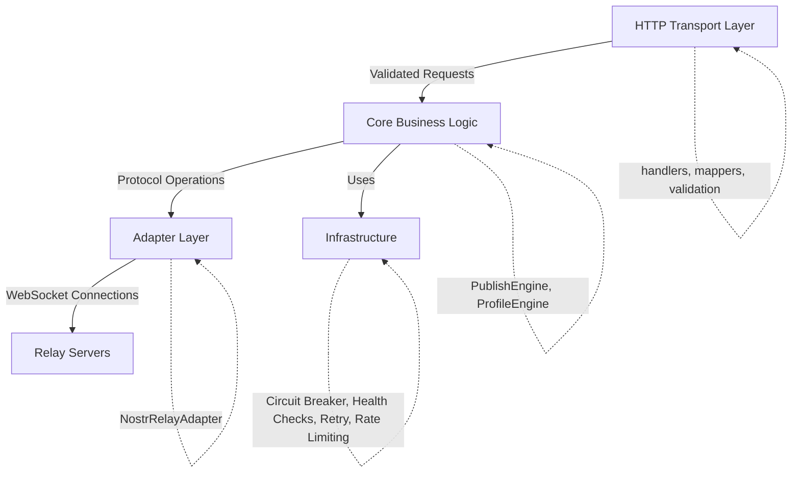
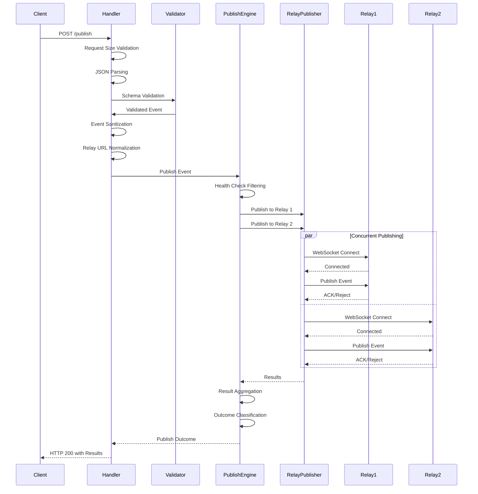
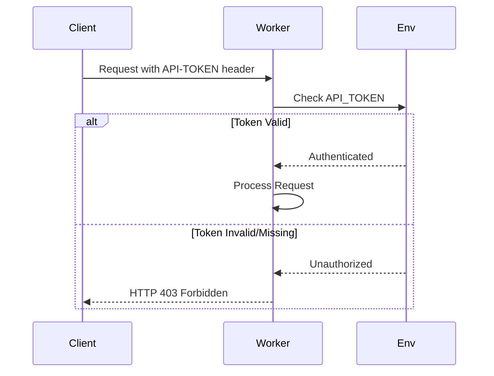

# Architecture Documentation

> 📖 **See Also**: [README.md](../README.md) for quick start and overview. [API.md](API.md) for complete API reference.

## System Overview

The HTTP to Nostr Publisher is a Cloudflare Worker that provides an HTTP interface for publishing Nostr events to multiple relays concurrently. The system is designed for reliability, observability, and performance.

## Architecture Layers



## Component Responsibilities

### Transport Layer (`src/transport/http/`)

**handlers.ts**
- HTTP request/response handling
- Request parsing and validation
- Error response formatting
- Policy selection from query parameters

**mappers.ts**
- Request/response transformation
- Error to HTTP response mapping
- Response header creation

### Core Layer (`src/core/`)

**PublishEngine.ts**
- Orchestrates concurrent publishing to multiple relays
- Manages overall timeouts and concurrency limits
- Aggregates results and classifies outcomes
- Health check integration

**RelayPublisher.ts**
- Individual relay connection management
- Retry logic with exponential backoff
- Timeout handling (connection and publish)
- Circuit breaker integration

**ProfileEngine.ts**
- Profile fetching from relays
- KV cache management
- Async refresh logic

**BatchPublisher.ts**
- Batch event publishing coordination
- Concurrent event processing

**EventValidator.ts**
- Nostr event structure validation
- Signature validation
- Uses Valibot schemas

**RelayUrl.ts**
- Relay URL normalization
- Validation and deduplication

### Adapter Layer (`src/adapters/nostr/`)

**relayAdapter.ts**
- WebSocket connection management
- Nostr protocol message handling
- Connection lifecycle

### Infrastructure (`src/core/`, `src/middleware/`)

**circuitBreaker.ts**
- Tracks relay failure rates
- Opens/closes circuits dynamically
- Prevents cascading failures

**healthCheck.ts**
- Periodic relay health monitoring
- Health status tracking
- Influences relay selection

**retry.ts**
- Exponential backoff implementation
- Configurable retry attempts

**rateLimiter.ts**
- Sliding window rate limiting
- Per-client tracking (IP or API token)

**cors.ts** (middleware)
- CORS header management
- Origin validation
- Preflight handling

### Policies (`src/policies/`)

Configurable behavior objects:
- **defaultPolicy**: Balanced approach
- **conservativePolicy**: Reliability-focused
- **aggressivePolicy**: Speed-focused
- **ProfilePolicy**: Profile-specific settings

### Observability (`src/observability/`)

**logger.ts**
- Structured logging with correlation IDs
- Multiple logger implementations

**metrics.ts**
- Counter, histogram, gauge metrics
- Metrics export interface

**tracing.ts**
- Span-based tracing (interface)

### Security (`src/security/`)

**sanitizer.ts**
- Content size limits
- Tag validation
- XSS prevention

### Validation (`src/validation/`)

**schemas.ts**
- Valibot schema definitions
- Request validation
- Error field extraction

## Data Flow

### Publish Flow



### Profile Flow

```mermaid
sequenceDiagram
    participant Client
    participant Handler
    participant KV
    participant ProfileEngine
    participant Relay1
    participant Relay2
    
    Client->>Handler: POST /profile
    Handler->>Handler: Validation
    Handler->>KV: Check Cache
    alt Profile Cached
        KV-->>Handler: Cached Profile
        Handler->>ProfileEngine: Trigger Background Refresh (if stale)
        Handler-->>Client: HTTP 200 (Cached)
    else Profile Not Cached
        KV-->>Handler: Not Found
        Handler-->>Client: HTTP 202 (Accepted)
        Handler->>ProfileEngine: Background Fetch
        par Try Relays
            ProfileEngine->>Relay1: Fetch Profile
            Relay1-->>ProfileEngine: Profile Event
        or
            ProfileEngine->>Relay2: Fetch Profile
            Relay2-->>ProfileEngine: Profile Event
        end
        ProfileEngine->>KV: Cache Result
    end
```

## Design Patterns

### Circuit Breaker

Prevents cascading failures by:
1. Tracking failure rates per relay
2. Opening circuit after threshold failures
3. Blocking requests to open circuits
4. Attempting recovery (half-open state)
5. Closing circuit after successful operations

### Retry with Exponential Backoff

Handles transient failures:
1. Configurable max attempts
2. Exponential delay: `backoffMs * 2^attempt`
3. Jitter to prevent thundering herd
4. Abort signal support for cancellation

### Health Checks

Proactive relay monitoring:
1. Tracks consecutive failures
2. Marks relays as unhealthy after threshold
3. Filters unhealthy relays from publishing
4. Periodic health status updates

### Policy Pattern

Configurable behavior via policy objects:
- Different policies for different use cases
- Query parameter selection
- Consistent interface across policies

## Concurrency Model

The system uses a concurrency limiter that:
1. Processes items up to the limit concurrently
2. Waits for completion when at limit
3. Cleans up completed promises
4. Prevents memory leaks

## Error Handling

Structured error hierarchy:
- `AppError`: Base error class
- `ValidationError`: Input validation failures
- `RelayError`: Relay-specific errors
- `TimeoutError`: Timeout scenarios
- `ConfigurationError`: Configuration issues

All errors include:
- Message
- HTTP status code
- Optional field (for validation errors)
- Optional suggestion
- Optional details object

## Timeout Strategy

Multi-level timeout handling:
1. **Connection Timeout**: Time to establish WebSocket connection
2. **Per-Relay Timeout**: Total time for a single relay operation
3. **Overall Timeout**: Total time for all relays
4. **Worker Timeout**: Cloudflare's 30s hard limit (warned at 25s)

## Security Deep Dive

### Authentication Flow



**Authentication Details:**
- If `API_TOKEN` environment variable is set, all requests require `API-TOKEN` header
- Token comparison is case-sensitive and exact match
- Missing token returns 403 Forbidden
- Invalid token returns 403 Forbidden
- Health endpoint (`/health`) is exempt from authentication

### Input Validation

**Validation Layers:**

1. **Request Size Validation**
   - Single requests: 1MB maximum
   - Batch requests: 10MB maximum
   - Early rejection prevents DoS attacks

2. **Schema Validation (Valibot)**
   - All request bodies validated against strict schemas
   - Type checking (strings, numbers, arrays, objects)
   - Format validation (hex strings, URLs, timestamps)
   - Required field validation

3. **Event Validation**
   - Event structure validation
   - Signature format validation (128-char hex)
   - ID and pubkey format validation (64-char hex)
   - Kind validation (0-65535)
   - Created_at validation (non-negative integer)

4. **Relay URL Validation**
   - URL format validation
   - Scheme validation (wss://, ws://, https://, http://)
   - Normalization (trimmed, deduplicated, max 12 relays)

### Sanitization

**Content Sanitization:**
- Content size limits enforced
- Tag structure validation
- XSS prevention through proper encoding
- No script execution in content

**Tag Validation:**
- Tags must be arrays of strings
- Tag structure validated
- Size limits enforced

### Rate Limiting

**Sliding Window Algorithm:**
- Tracks requests per client identifier (IP or API token)
- Configurable window size (default: 60 seconds)
- Configurable request limit (default: 100 requests)
- Returns `Retry-After` header on rate limit exceeded

**Rate Limit Headers:**
- `Retry-After`: Seconds until rate limit resets (on 429 responses)

### Request Size Limits

- **Single Request**: 1MB maximum
- **Batch Request**: 10MB maximum
- **Early Rejection**: Prevents DoS via large payloads
- **Clear Error Messages**: Returns 400 with size information

### Security Best Practices

1. **Always Set API_TOKEN**: Protect worker from unauthorized access
2. **Use HTTPS/WSS**: Always use secure protocols for relay URLs
3. **Validate Events Client-Side**: Don't rely solely on server validation
4. **Monitor Rate Limits**: Set appropriate limits to prevent abuse
5. **Regular Security Audits**: Review logs for suspicious patterns
6. **Keep Dependencies Updated**: Regularly update npm packages
7. **Use CORS Wisely**: Only enable CORS for trusted origins
8. **Monitor KV Usage**: Profile cache could be abused if not rate-limited

### Threat Mitigation

| Threat | Mitigation |
|--------|------------|
| Unauthorized Access | API_TOKEN authentication |
| DoS via Large Payloads | Request size limits (1MB/10MB) |
| DoS via Request Volume | Rate limiting per client |
| Invalid Input | Multi-layer validation |
| XSS Attacks | Content sanitization |
| Relay Spoofing | URL validation and normalization |
| Cache Poisoning | KV access controls and validation |

## Observability

### Logging
- Structured logging with correlation IDs
- Request/response logging
- Error logging with context

### Metrics
- Counter metrics (success/failure counts)
- Histogram metrics (latency distributions)
- Gauge metrics (current state)

### Tracing
- Span-based tracing interface
- Operation timing
- Child span support

## Configuration

Environment variables control:
- API token authentication
- Rate limiting thresholds
- CORS origins
- Metrics export settings
- KV namespace binding

## Testing Strategy

- **Unit Tests**: Core logic validation
- **Integration Tests**: HTTP handlers
- **Property Tests**: Validation edge cases
- **Chaos Tests**: Failure scenarios, timeouts, concurrency

## Performance Characteristics

### Throughput and Latency

- **Concurrent Publishing**: Up to 8-12 relays simultaneously (policy-dependent)
  - Default: 8 concurrent operations
  - Conservative: 4 concurrent operations (more reliable)
  - Aggressive: 12 concurrent operations (higher throughput)
- **Typical Latency**: 100-500ms per relay (varies by relay response time)
- **Overall Request Time**: 1-15 seconds (policy-dependent, typically 2-5 seconds)
- **Batch Processing**: All events in a batch are processed concurrently

### Resource Usage

- **Memory**: Minimal per-request overhead (~1-2MB per concurrent operation)
- **CPU**: Efficient async/await pattern, minimal blocking
- **Network**: WebSocket connections are pooled and reused where possible
- **KV Storage**: Profile cache uses Cloudflare KV (global, low-latency)

### Scaling Considerations

- **Cloudflare Workers**: Automatically scales to handle traffic spikes
- **No State Management**: Stateless design allows horizontal scaling
- **KV Limits**: Profile cache limited by Cloudflare KV quotas
- **Concurrency Limits**: Policy-based limits prevent resource exhaustion
- **Rate Limiting**: Built-in per-client rate limiting prevents abuse

### Optimization Strategies

1. **Health Filtering**: Skips known-bad relays, reducing wasted time
2. **Circuit Breakers**: Prevents cascading failures and wasted requests
3. **Request Size Validation**: Early rejection of oversized requests (1MB single, 10MB batch)
4. **Timeout Handling**: Fast failure for unhealthy relays (prevents blocking)
5. **Concurrent Publishing**: Parallel operations maximize throughput
6. **Profile Caching**: KV cache reduces relay queries by ~90% for repeated requests

### Performance Benchmarks

Typical performance metrics (measured with default policy, 3 relays):

- **Single Event Publish**: 200-800ms (depending on relay response times)
- **Batch of 10 Events**: 500-2000ms (concurrent processing)
- **Batch of 100 Events**: 3-8 seconds (with concurrency limits)
- **Cached Profile Fetch**: <50ms (KV lookup)
- **Uncached Profile Fetch**: 200-500ms (first request), then cached

### Bottlenecks and Limits

- **Cloudflare Worker Timeout**: Hard 30-second limit (system warns at 25s)
- **Relay Response Times**: Slowest relay determines overall latency
- **Concurrency Limits**: Policy-based limits may cause queuing under high load
- **Request Size**: 1MB single, 10MB batch limits payload size
- **Relay Count**: Maximum 12 relays per request (normalization limit)
